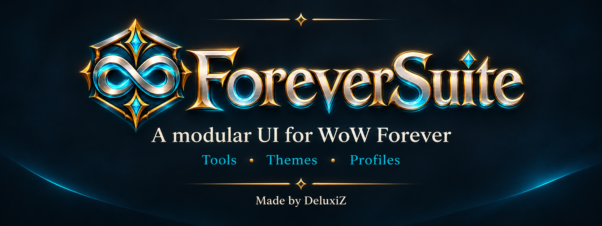
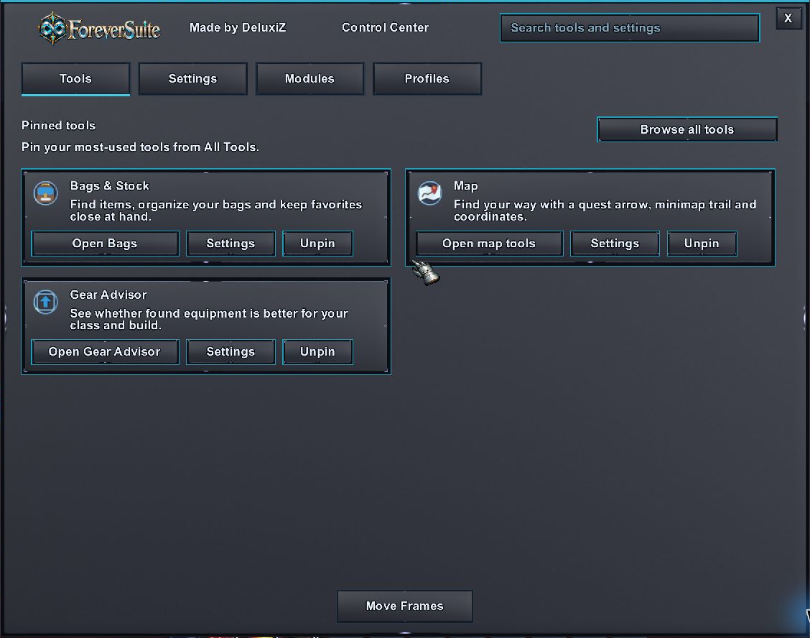
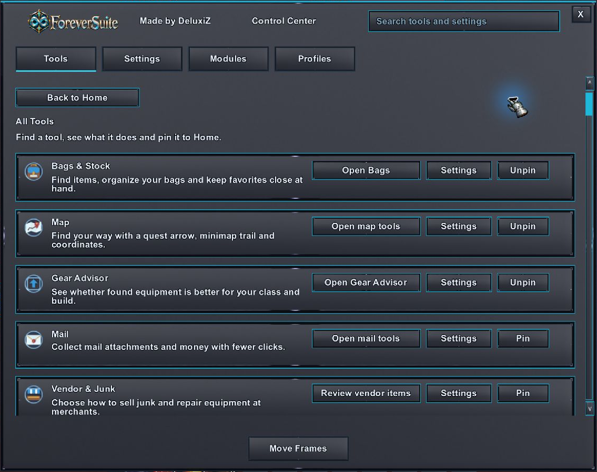
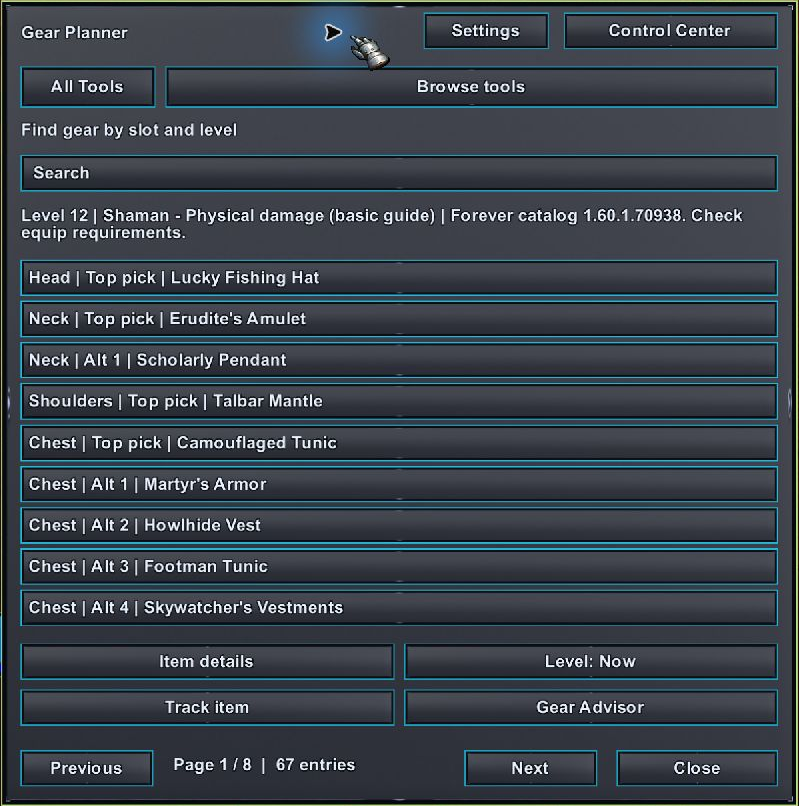

# ForeverSuite



**Your everyday interface and tools, together in one Control Center.**

Choose a theme, arrange your interface and pin the tools you use most.
Enable the modules you want and save your setup in a profile.
Made by **DeluxiZ** for **WoW Forever**.

[Download the latest release](https://github.com/Bovahkiin/ForeverSuite/releases/latest) ·
[CurseForge](https://www.curseforge.com/wow/addons/foreversuite-by-deluxiz) ·
[Discord support & community](https://discord.gg/wmBcax2bvJ)

## Install

- **WowUp:** select your WoW Forever installation and search for **ForeverSuite**.
  You can also use **Install from URL** with this repository's address.
- **CurseForge:** download the WoW Forever file from the
  [ForeverSuite project](https://www.curseforge.com/wow/addons/foreversuite-by-deluxiz/files/all).
- **Manual:** download `ForeverSuite-<version>-forever.zip` from
  [GitHub Releases](https://github.com/Bovahkiin/ForeverSuite/releases/latest).
  Extract these three folders side by side into your AddOns folder:

  ```text
  World of Warcraft/_forever_/Interface/AddOns/
  ├── ForeverSuite/
  ├── ForeverSuite_GearData/
  └── ForeverSuite_ProfessionData/
  ```

Enable all three in the game's AddOns list. `ForeverSuite.toc` should sit directly
inside `ForeverSuite/`. Use the attached release ZIP for manual installation.
The two data addons load when their tools need them.

## Make it yours

1. On first login, choose **Start ForeverSuite Tour** or **Skip ForeverSuite Tour**.
   Guided Setup lets you choose your theme, layout and play style before applying them.
2. Type **`/fs`** to open the Control Center. **Tools** is your home for pinned shortcuts.
3. Open **Browse all tools** to see what each tool does, open it or change its
   settings. Use **Pin** to keep it on your home screen.
4. Use **Settings** for customization, **Modules** to enable or disable features,
   and **Profiles** to save or switch your setup.

Search tools and settings from the top bar. **Move Frames** lets you reposition
supported elements; native action-bar placement uses the game's Edit Mode.
Right-click the minimap button for quick access to profiles, themes and layouts.

Nameplates distinguish hostile NPCs (red) from neutral NPCs you can attack
(yellow). Friendly units are green by default. Change these under
**Nameplates → Open nameplate designer → Colors**, and cycle the reaction preview
to compare them. Optional aggro colors and player class colors take precedence.

## What's included

| Area | Tools and customization |
| --- | --- |
| Interface | Visual themes, layout presets, fonts, movable frames and a guided first-run setup. |
| Combat UI | Action bars with mouseover and idle opacity, quick keybind mode, unit frames, nameplates, buffs and cooldown tools. |
| Inventory | Bags, item favorites, recorded character stock, junk selling, repairs, shopping lists and mail tools. |
| Maps & quests | Quest tracker, saved pins, waypoint queues, Route Library and gathering-run reports. |
| Equipment & talents | Gear Advisor, Gear Planner, Gear Wishlist, Talent Advisor, durability tracking and Character Overview. |
| Dungeons & raids | Dungeon & Raid Journal, recorded loot, preparation checklists and private run notes. |
| Professions | Recipe browsing, crafting plans, material lists, skill-up suggestions, level routes, trainer references and Train all in trainer windows. |
| Social & profiles | Chat tools, private guild notes, optional group history, profile import/export, backups and settings undo. |

Gear Planner combines the built-in equipment catalog with equipped items,
recorded drops and your wishlist. Its recommendations use your Gear Advisor
weights. Check item requirements and special effects when comparing equipment.

**Talent Advisor** provides 73 guide build variants for all nine classes, based on
[Icy Veins' WoW Forever guides](https://www.icy-veins.com/wow-forever/).
Open **Talent Advisor** directly from the game's **Talents** screen, from All
Tools or with `/fs talents`. Choose a build, compare learned talents, plan legal points or save your own
variation. Share builds through copyable codes and keep an account-wide library
in DataHub. Build profiles combine a plan and gear preferences, with an optional
layout and undo. Plans never spend or reset talents for you.

The normal Talents screen highlights the build you follow: **gold** marks the
next legal point, **blue** planned talents, **green** matched planned ranks and
**purple** flexible choices. **P5**, for example, means five ranks are planned.
Pending changes pause next-point guidance until applied or canceled. Inspecting
another character hides your build highlights. You can disable the highlights
in Talent Advisor settings while keeping the shortcut available.

Gear Advisor's optional talent link uses the selected build's starter role scale.
The displayed PvE stat reference is not a set of simulated weights and may differ
for leveling or PvP. Check stat caps, item effects and your own situation in the
linked guide. See [talent data coverage](Modules/TalentAdvisor/DATA_SOURCES.md).

At a **class, pet or profession trainer**, use **Train all** beside the normal
Train button. Review the coin cost, then confirm. It trains only the approved
available lessons with known coin costs; new unlocks need another approval.
Closing the trainer or entering combat stops training. Toggle the button in
Quality of Life settings.

DataHub keeps account-wide character records separate from UI profiles. Your
name, realm, level, class, faction and last-seen time update automatically.
Use **Character stock → Record character** to refresh recorded bags, equipment
and professions. These snapshots show when they were recorded; they are not
live views of logged-out characters. Existing Character stock data is imported
once, and the original saved data is retained.

Profession routes and trainer references combine bundled data with information
recorded in game. See the [gear catalog coverage](ForeverSuite_GearData/DATA_SOURCES.md)
and [profession data coverage](ForeverSuite_ProfessionData/DATA_SOURCES.md) for details.

## Current previews

These are real screenshots of **ForeverSuite 1.0.7**, cropped to the addon windows.
The interface contents have not been generated or retouched. Appearance and
available entries depend on your theme, character and enabled modules.

### Control Center

Keep frequently used tools on your home screen, with separate buttons to open
each tool or its settings.



<details>
<summary>All Tools — descriptions, direct access and pinning</summary>



</details>

<details>
<summary>Gear Planner — equipment by slot, level and source</summary>



</details>

## Useful commands

| Command | Action |
| --- | --- |
| `/fs` | Open the Control Center. |
| `/fs setup` | Reopen Guided Setup. |
| `/fs tour` | Start the ForeverSuite Tour. |
| `/fs help` | Open layout recovery. |
| `/fs addons` | Choose supported addon systems. |
| `/fs tools` | Open the tool browser at its last selected tool. |
| `/fs talents` | Open Talent Advisor. |
| `/fs undo` | Undo the last supported settings change. |
| `/fs status` | Show client and compatibility information. |
| `/fs errors` | Show blocked addon actions recorded during this session. |
| `/fs audit` | Open maintenance and layout diagnostics. |

## Compatibility & local data

ForeverSuite targets **WoW Forever**. Available features depend on the APIs exposed
by that client. Use **`/fs addons`** to choose between supported navigation or
nameplate systems when using other interface addons.

For a seamless world map, ForeverSuite can work with
[OpenMap](https://github.com/openmap-world/openmap). Select OpenMap's seamless view
from its map menu. Saved pins and route stops appear across supported zones.
Waypoint arrows and ant trails provide direct guidance rather than terrain-aware routing.

Chat capture and recent-group history are optional. Guild notes are private addon
notes. Profile exports omit private guild notes and recorded histories. Settings
undo applies to supported preferences; game actions such as sales remain final.

## Support, bug reports & suggestions

Please use the [ForeverSuite Discord](https://discord.gg/wmBcax2bvJ).
Open a support ticket for help or a bug report, or share your ideas in the
suggestions channel.

For a bug report, include:

- Your ForeverSuite version and the output of `/fs status`.
- What happened and the steps needed to reproduce it.
- A screenshot or the complete error message, if available.
- The output of `/fs errors` if the problem involves a blocked addon action.
- Other UI addons you are using and whether the issue also occurs with them disabled.

Remove private information from screenshots and logs before sharing them.

## Project information

- [Changelog](CHANGELOG.md) — changes in each release.
- [Roadmap](ROADMAP.md) — future plans.
- [In-game test checklist](IN_GAME_TEST.md) — checks for testers.
- [GitHub update instructions](GITHUB_UPDATES.md) — publishing information for maintainers.

Created by **DeluxiZ**, with AI-assisted development and Blender-rendered theme
assets. Licensed under the [MIT License](LICENSE). Third-party credits and asset
licenses are listed in [COPYRIGHT.txt](COPYRIGHT.txt).

ForeverSuite is a community project and is not affiliated with Blizzard Entertainment.
