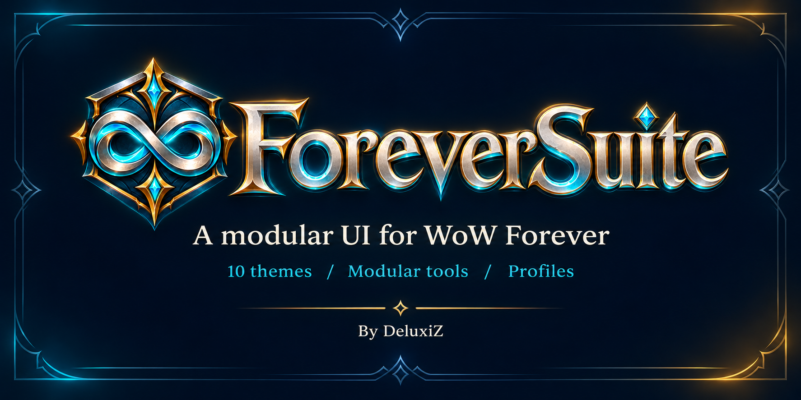
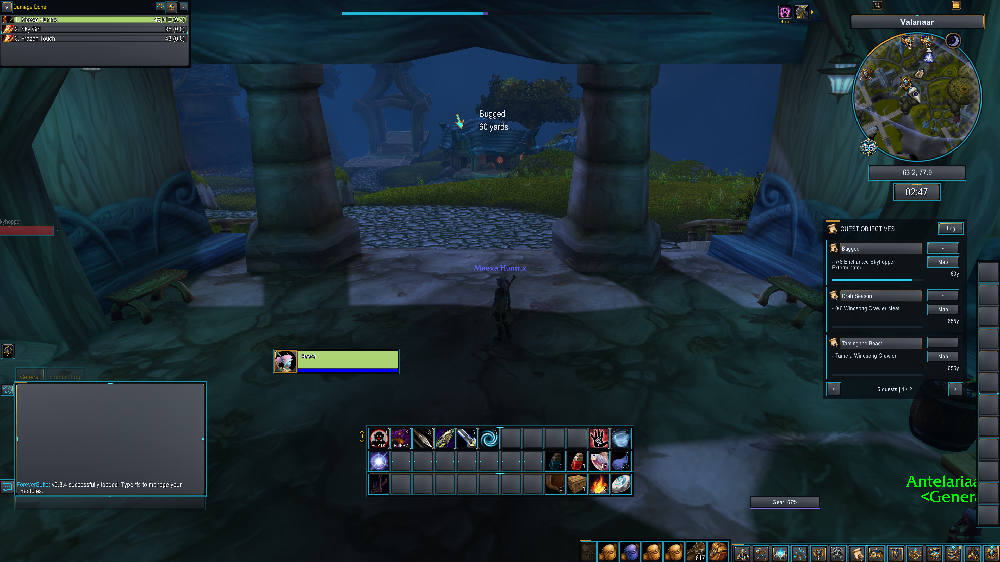
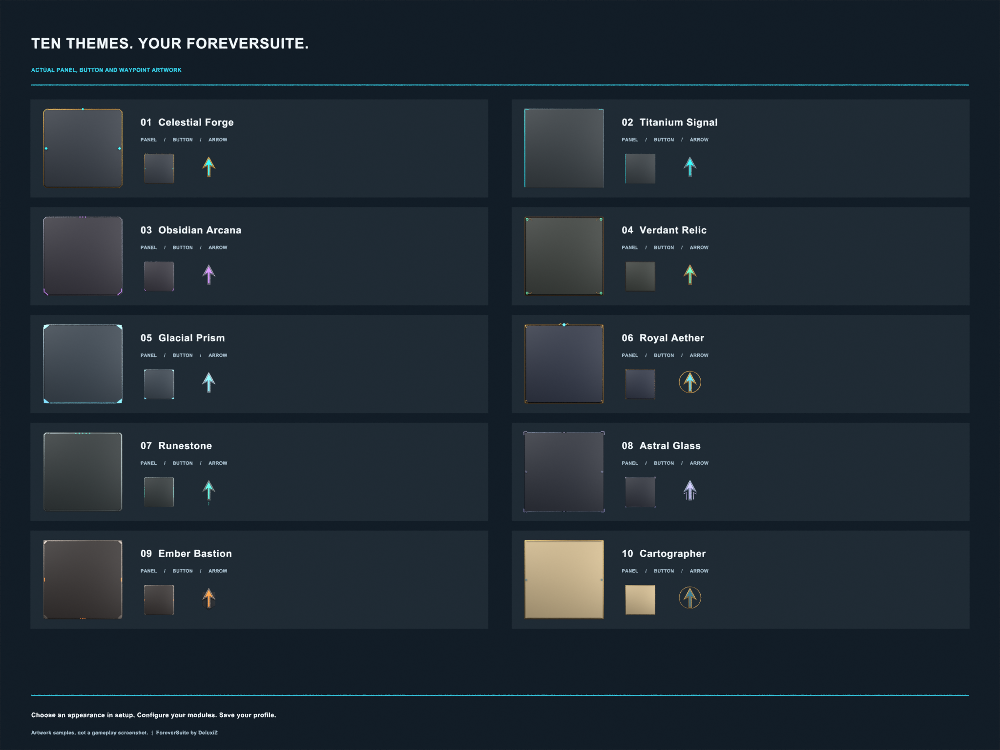

# ForeverSuite



**A customizable, modular interface for WoW Forever.**

ForeverSuite brings your everyday interface tools together in one Control Center.
Choose a visual theme, configure the modules you use, and save your setup in a
profile. Made by **DeluxiZ**.

**Current release:** 0.9.0 · **Client:** WoW Forever · **Interface:** 16001

## New in 0.9.0

- **Mail:** open a mailbox to use themed inbox tools, search letters and collect
  money/items. COD and GM mail are never collected automatically. Sending,
  deleting and returning mail stay with the game's normal controls.
- **Addon Buttons:** click the new minimap tray icon for your addon buttons.
  Open its module to exclude icons or change size, spacing and column count.
  Recognized addon buttons are collected; secure/native controls are excluded.
- **Gear Advisor:** automatic beginner stat guides for each class, with role
  choices for hybrids. Start with **Auto** and **Class default**, then choose
  **Class guide** for plain-language help. Custom weights are optional.
  Scores compare item stats, not actual DPS: equip requirements, procs, sockets
  and set effects still need manual judgement. Custom scale text uses entries
  such as `Agility=2, Stamina=0.2`; this is not a Pawn scale importer.

## Features

- **Guided setup:** a welcome screen, patch notes, ten visual themes with previews,
  accessibility presets, and quick module choices.
- **Consistent customization:** module colors, font family, size and outline
  settings, plus movable and resizable supported frames with a centered grid.
- **Action bars and unit frames:** configurable bar appearances, player and target
  frames, an optional pet frame, levels, portraits, and cast bars.
- **Nameplates:** a layout designer, health and cast information, saved NPC rules,
  and emphasis for selected important spells.
- **Bags and vendors:** inventory categories, favorites, recent items, stock tools,
  configurable junk selling and repairs, item checklists, and manual buyback.
- **Map and quests:** a themed map interface, coordinates, saved pins, a quest
  tracker, automatic quest waypoints, a smooth direction arrow, minimap ant trails,
  and a waypoint queue.
- **Chat, social and guild:** separate modules, chat appearance options, keyword
  highlights, optional chat copying, private guild notes, favorites, and optional
  recent-group history.
- **More everyday tools:** loot and leveling session summaries, cooldown and buff
  tools, professions, auction information, and equipment durability tracking.
- **Profiles and settings tools:** profile import/export, automatic backups,
  character assignments, settings search, favorites, and undo for reversible
  settings changes.
- **Faster Control Center:** search modules by name, feature or setting, filter
  enabled/disabled modules, and open a unique result with Enter. Clear or Escape
  resets the filters and returns to the module page you were browsing.

## Choosing addon systems

Open **Addon systems** in the Control Center or use `/fs addons`. When supported
competing addons are detected, ForeverSuite asks which system to use and remembers
the choice per character. Choose later leaves existing behavior unchanged.

- Waypoint adapters: RestedXP, Zygor and TomTom. Only their arrow options change;
  guide addons keep running. Unsupported API versions show an explanation.
- Nameplates: Plater, Platynator, Kui, Threat Plates, Tidy Plates and Neat Plates.
  **Apply and reload UI** changes supported addon enablement for this character,
  preserves dependencies/settings, and reloads. Unknown addons need an adapter.
- Choices stay separate from UI profiles and reversible settings undo.

## Previews

### In-game interface



An in-game screenshot supplied by the author. Module choices, appearance and
frame placement are configurable; this is one example layout.

<details>
<summary>See the artwork for all ten themes</summary>



These samples show the actual theme textures used by the addon. This comparison
is an artwork sheet, not a gameplay screenshot or a promised window layout.

</details>

## Installation

Maintaining this repository? See [GitHub update instructions](GITHUB_UPDATEN.md)
for GitHub Desktop and the **Nieuwe release maken** release button.

1. Download the attached **ForeverSuite ZIP** from this repository's **Releases**
   page.
2. Extract the `ForeverSuite` folder into your WoW Forever installation:

   ```text
   World of Warcraft/_forever_/Interface/AddOns/ForeverSuite/
   ```

3. Check that `ForeverSuite.toc` is directly inside that folder. Avoid an extra
   nested `ForeverSuite/ForeverSuite` folder.
4. Enable ForeverSuite in the game's AddOns list, then log in. If you updated it
   while the game was open, type `/reload` after copying finishes.

Download the release ZIP attached by the author rather than GitHub's automatically
generated source archive.

## Getting started

The first-use setup lets you preview an appearance before applying it. You can
skip setup and return later with `/fs setup`.

Open `/fs` to access the Control Center. Click a module card to open its settings,
or use its Enabled button to toggle the module. Profiles remain accessible across
the Control Center's module pages.

Use the search field above the cards to find a module or feature. The filter
button cycles through all modules, enabled modules and disabled modules. Muted
icons identify disabled modules; their settings remain available on the card.

Use **Move Frames** to reposition supported elements and drag their resize grips
to change scale. Native secure action-bar placement remains controlled by the
game. Leave combat before making layout changes.

Open **More tools / search** for profile transfers, settings search, favorites,
alerts, notes, checklists, session information, and waypoint queues.

## Commands

| Command | Action |
| --- | --- |
| `/fs` | Open the Control Center |
| `/fs setup` | Reopen guided setup |
| `/fs tools` | Open More tools / search |
| `/fs undo` | Undo the last supported settings change |
| `/fs status` | Show client and compatibility information |
| `/fs errors` | Show blocked addon actions recorded during this session |
| `/fs audit` | Open maintenance and layout diagnostics |

## Waypoint navigation

Enable navigation in the Map module and select the automatic quest options you
prefer. Quest navigation depends on location information exposed by the client.

- Left-click the waypoint arrow to open the map.
- Right-click the arrow to stop navigation.
- To resume a quest waypoint, enable **Follow clicked quest** and click **Map**
  beside that quest in the ForeverSuite quest tracker.

Ant trails point directly toward the destination. They do not calculate routes
along roads or around terrain.

## Local data

Chat capture and recent-group tracking are optional. Chat copying keeps up to 200
messages for the current session. Guild notes are private addon notes; they do
not edit public or officer notes.

Profile exports omit private guild notes, recent-group history, and recorded
histories. Undo applies to supported settings changes, not purchases, sales,
messages, or other game actions.

## Compatibility and testing

ForeverSuite targets **WoW Forever**. Compatibility with Retail or other Classic
clients is not established. Some features require client APIs that may be
unavailable or restricted; those features skip unreadable data.

The current development checks cover **317 offline scenarios**, Lua startup,
runtime textures, and targeted map regressions. Offline checks do not reproduce
every aspect of the game. In version 0.8.5, the author has confirmed that layout
restoration survives reload and that combat and logout no longer produce the
previously reported blocked-action warnings in their setup. This confirmation
covers that setup; broader client, class and addon-combination testing continues.

## Reporting issues

Open an issue in this repository and include:

- Your ForeverSuite version and the output of `/fs status`.
- What you expected, what happened, and steps to reproduce it.
- A screenshot or the complete error text, where available.
- Relevant output from `/fs errors` for blocked-action warnings.
- Whether it also happens with other interface addons disabled.

Please remove personal information from screenshots and logs before posting.

## Documentation

- [Changelog](CHANGELOG.md)
- [Tools and settings guide](NEW_TOOLS.md)
- [Feature delivery status](DELIVERY_STATUS.md)
- [In-game test checklist](IN_GAME_TEST.md)

## License

ForeverSuite is licensed under the [MIT License](LICENSE).
Copyright © 2026 DeluxiZ.

Third-party components, fonts and assets retain their respective copyright and
licensing terms. See [COPYRIGHT.txt](COPYRIGHT.txt).

## Credits

Created by **DeluxiZ**, with AI-assisted development and original Blender-rendered
theme assets.

Copyright © 2026 DeluxiZ. See [COPYRIGHT.txt](COPYRIGHT.txt).

ForeverSuite is a community project and is not affiliated with Blizzard
Entertainment. Third-party assets and fonts retain their respective licensing
terms.
