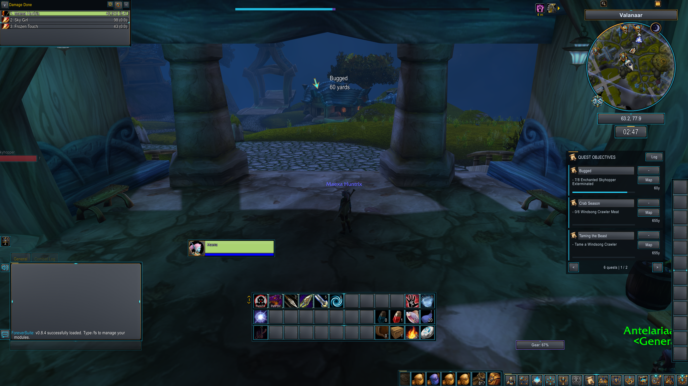
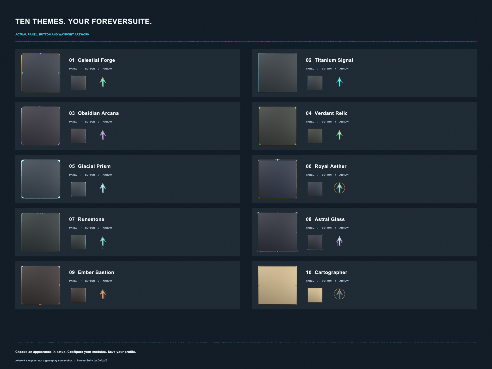
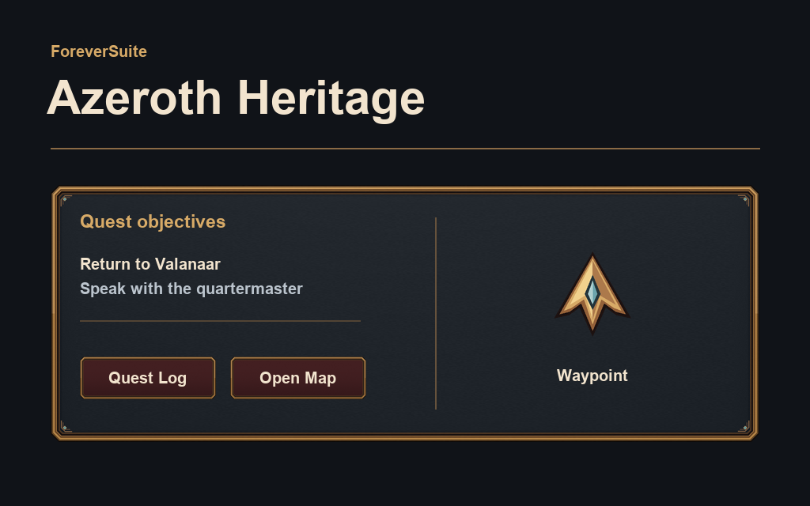

# ForeverSuite


**A customizable, modular interface for WoW Forever.**

ForeverSuite brings your everyday interface tools together in one Control Center.
Choose a visual theme, configure the modules you use, and save your setup in a
profile. Made by **DeluxiZ**.

[Join the ForeverSuite Discord](https://discord.gg/wmBcax2bvJ) for support, bug reports, and suggestions.

**Current release:** 1.0.7 · **Client:** WoW Forever · **Interface:** 16001

## Getting started

- On first login, start the ForeverSuite Tour or go straight to Guided Setup.
  Choose a theme, layout and play style. Review the choices
  and select **Apply & finish** to save them to your current profile. For a
  faster start, pick **Use recommended settings**.
- On the **Tools** tab, open **Browse all tools** for descriptions and click
  **Pin** to keep a shortcut on your home screen.
- On the **Settings** tab, select a module for its main options. **More options** opens the full
  settings. Both screens have **Back to Control Center**.
- In **General settings**, open **Quick tour** for tips on tools, moving frames and profiles.
  **Help with layout** can bring saved frames back on screen or undo a change.
- Type a task in the Control Center search field and press Enter, or open
  **Find a setting** and search as you type. Try `text size`, `restore waypoint`,
  `feed pet` or `move bags`.
- Use **Modules** to enable or disable features, **Profiles** to save or switch
  your setup, or **Character Overview** in All Tools to check your character.
- Right-click the minimap button for profiles, themes, layouts and other shortcuts.

## Features

- **Guided setup:** five starter themes, three starting layouts, four play-style
  choices, an optional text preview and a short tour. All eleven themes and
  additional layouts remain available from Control Center and the minimap menu.
- **Consistent customization:** module colors, font family, size and outline
  settings, plus movable and resizable supported frames with a centered grid.
- **Action bars and unit frames:** mouseover and idle opacity, quick keybind mode,
  configurable bar appearances, player and target frames, an optional pet frame,
  levels, portraits and cast bars.
- **Nameplates:** a layout designer, health and cast information, saved NPC rules,
  and emphasis for selected important spells.
- **Bags and vendors:** inventory categories, favorites, recent items, stock tools,
  configurable junk selling and repairs, item checklists, and manual buyback.
- **Map and quests:** a themed map interface, coordinates, saved pins, a quest
  tracker, automatic quest waypoints, a smooth direction arrow, minimap ant trails,
  and a waypoint queue.
- **Chat, social and guild:** separate modules, chat appearance options, keyword
  highlights, optional chat copying, private guild notes, favorites, and optional
  recent-group history.
- **Professions:** open a profession in WoW, then use **Professions → View** in
  ForeverSuite. **Skill-ups** ranks learned recipes by their current color,
  available materials and recorded material cost. **Market** estimates cost
  and margin before auction fees using saved per-item prices. **Recipe book**
  also lists unlearned recipes visible to the game. Select a recipe to plan
  quantities and send missing materials to the shopping list.
- **Level routes:** use **Professions → View → Level routes** to plan a custom
  skill range up to 300 for 12 professions. Training steps show observed
  trainers where available. Crafting routes estimate the minimum direct
  ingredients and flag recipes with an unconfirmed source.
  [Profession data and coverage](ForeverSuite_ProfessionData/DATA_SOURCES.md)
- **More everyday tools:** loot and leveling session summaries, cooldown and buff
  tools, auction information, and equipment durability tracking.
- **Profiles and settings tools:** profile import/export, automatic backups,
  character assignments, settings search, favorites, and undo for reversible
  settings changes.
- **1.0 planning tools:** Layout Studio, selective profile import, crafting plans,
  character stock records, shared waypoint routes and profession area guides.
  The Dungeon & Raid Journal links observed drops to the Gear Wishlist, preparation
  checklists and private boss notes.
- **Gear Planner:** open **Gear Advisor → Gear planner** to compare known items
  per slot for your current level or levels 20, 30, 40, 50 and 60. Search by
  slot, item or source and track an item in Gear Wishlist. Recommendations use
  your Gear Advisor weights and combine the built-in WoW Forever equipment
  catalog with your equipped gear, observed drops and wishlist.
  [Catalog sources and coverage](ForeverSuite_GearData/DATA_SOURCES.md)
- **Faster Control Center:** search modules by name, feature or setting, filter
  enabled/disabled modules, and open a unique result with Enter. Clear or Escape
  resets the filters and returns to the module page you were browsing.

## Choosing addon systems

Open **Addon systems** in the Control Center or use `/fs addons`. When supported
competing addons are detected, ForeverSuite asks which system to use and remembers
the choice per character. Choose later leaves existing behavior unchanged.

- Waypoint adapters: RestedXP, Zygor and TomTom. Only their arrow options change;
  guide addons keep running. Unsupported API versions show an explanation.
- Nameplates: Plater, Platynator, Kui, Threat Plates, Tidy Plates and Neat Plates.
  **Apply and reload UI** changes supported addon enablement for this character,
  preserves dependencies/settings, and reloads. Unknown addons need an adapter.
- Choices stay separate from UI profiles and reversible settings undo.

## Seamless world map

Install and enable [OpenMap](https://github.com/openmap-world/openmap) for WoW
Forever to zoom and pan across supported zones with the normal world-map key.
Choose OpenMap's seamless view from its map menu. With that view active,
ForeverSuite shows your saved pins and numbered route stops across supported
zones and **My zone** brings the view back to your character. OpenMap manages
the map window's position and size. The regular world map is available through
OpenMap or by playing with ForeverSuite alone.

## Previews

### In-game interface



An in-game screenshot supplied by the author. Module choices, appearance and
frame placement are configurable; this is one example layout.

<details>
<summary>See the original ten themes</summary>



These samples show the actual theme textures used by the addon. This comparison
is an artwork sheet, not a gameplay screenshot or a promised window layout.

</details>

### Azeroth Heritage

Dark slate panels, aged brass trim, burgundy buttons and a gold-and-blue
waypoint arrow inspired by the classic WoW Forever interface.



## Installation

Maintaining this repository? See [GitHub update instructions](GITHUB_UPDATES.md)
for GitHub Desktop and the **Build ForeverSuite Release** workflow.

1. Download the attached **ForeverSuite ZIP** from this repository's **Releases**
   page.
2. Extract all three folders side by side into your WoW Forever AddOns folder.

   ```text
   World of Warcraft/_forever_/Interface/AddOns/ForeverSuite/
   World of Warcraft/_forever_/Interface/AddOns/ForeverSuite_GearData/
   World of Warcraft/_forever_/Interface/AddOns/ForeverSuite_ProfessionData/
   ```

3. Check that `ForeverSuite.toc` is directly inside that folder. Avoid an extra
   nested `ForeverSuite/ForeverSuite` folder.
4. Enable ForeverSuite and both data addons in the game's AddOns list, then
   log in. The catalogs load when you open Gear Planner or Level routes.
   If the game was open during a manual update, type `/reload` after copying.

Download the release ZIP attached by the author rather than GitHub's automatically
generated source archive.

## Getting started

The first-use setup lets you preview an appearance before applying it. You can
skip setup and return later with `/fs setup`.

Open `/fs` to access the Control Center. Click a module card to open its settings,
or use its Enabled button to toggle the module. Profiles remain accessible across
the Control Center's module pages.

Use the search field above the cards to find a module or feature. The filter
button cycles through all modules, enabled modules and disabled modules. Muted
icons identify disabled modules; their settings remain available on the card.

Use **Move Frames** to reposition supported elements and drag their resize grips
to change scale. Select a handle to center it, place it below the player, or
restore that frame. Native action-bar placement remains in the game's Edit Mode.
Leave combat before making layout changes.

Open **More tools** for profile transfers, settings search, favorites,
alerts, notes, checklists, session information, and waypoint queues.

## Commands

| Command | Action |
| --- | --- |
| `/fs` | Open the Control Center |
| `/fs setup` | Reopen guided setup |
| `/fs help` | Open layout recovery |
| `/fs tour` | Start the three-tip tour |
| `/fs tools` | Open More tools |
| `/fs undo` | Undo the last supported settings change |
| `/fs status` | Show client and compatibility information |
| `/fs errors` | Show blocked addon actions recorded during this session |
| `/fs audit` | Open maintenance and layout diagnostics |

## Waypoint navigation

Enable navigation in the Map module and select the automatic quest options you
prefer. Quest navigation depends on location information exposed by the client.

- Left-click the waypoint arrow to open the map.
- Right-click the arrow to stop navigation.
- To resume a quest waypoint, enable **Follow clicked quest** and click **Map**
  beside that quest in the ForeverSuite quest tracker.

Ant trails point directly toward the destination. They do not calculate routes
along roads or around terrain.

## Local data

Chat capture and recent-group tracking are optional. Chat copying keeps up to 200
messages for the current session. Guild notes are private addon notes; they do
not edit public or officer notes.

Profile exports omit private guild notes, recent-group history, and recorded
histories. Undo applies to supported settings changes, not purchases, sales,
messages, or other game actions.

## Compatibility and testing

ForeverSuite targets **WoW Forever**. Compatibility with Retail or other Classic
clients is not established. Some features require client APIs that may be
unavailable or restricted; those features skip unreadable data.

The current development checks cover **377 offline scenarios**, Lua startup,
runtime textures, and targeted map regressions. Offline checks do not reproduce
every aspect of the game. In version 0.8.5, the author has confirmed that layout
restoration survives reload and that combat and logout no longer produce the
previously reported blocked-action warnings in their setup. This confirmation
covers that setup; broader client, class and addon-combination testing continues.

## Reporting issues

Open an issue in this repository and include:

- Your ForeverSuite version and the output of `/fs status`.
- What you expected, what happened, and steps to reproduce it.
- A screenshot or the complete error text, where available.
- Relevant output from `/fs errors` for blocked-action warnings.
- Whether it also happens with other interface addons disabled.

Please remove personal information from screenshots and logs before posting.

## Documentation

- [Changelog](CHANGELOG.md)
- [Tools and settings guide](NEW_TOOLS.md)
- [Feature delivery status](DELIVERY_STATUS.md)
- [In-game test checklist](IN_GAME_TEST.md)

## License

ForeverSuite is licensed under the [MIT License](LICENSE).
Copyright © 2026 DeluxiZ.

Third-party components, fonts and assets retain their respective copyright and
licensing terms. See [COPYRIGHT.txt](COPYRIGHT.txt).

## Credits

Created by **DeluxiZ**, with AI-assisted development and original Blender-rendered
theme assets.

Copyright © 2026 DeluxiZ. See [COPYRIGHT.txt](COPYRIGHT.txt).

ForeverSuite is a community project and is not affiliated with Blizzard
Entertainment. Third-party assets and fonts retain their respective licensing
terms.
